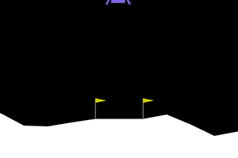
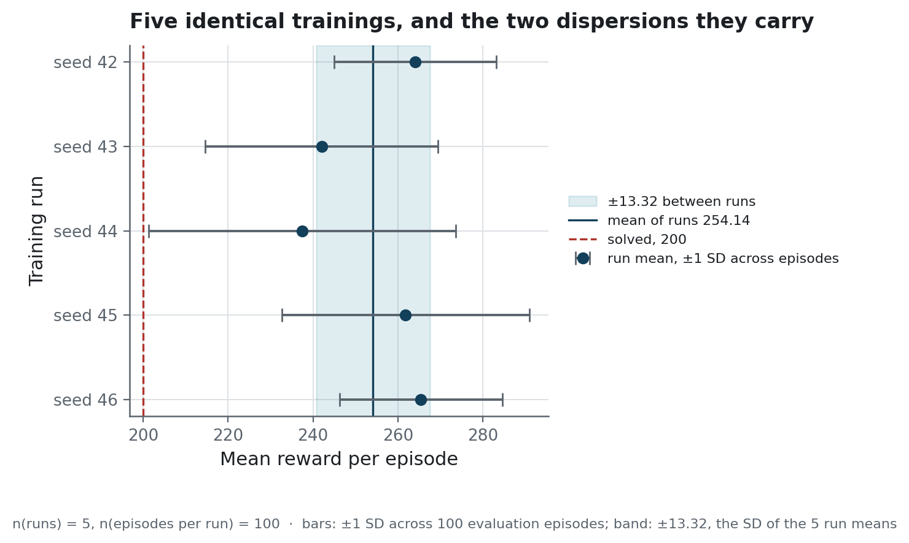
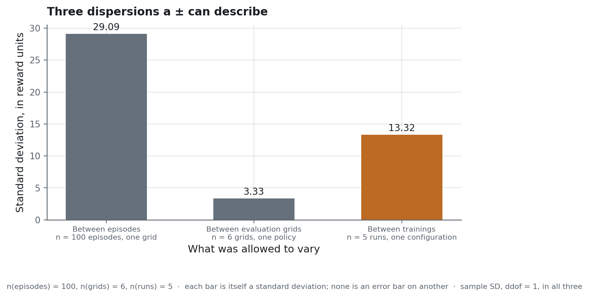

<h1 align="center">Lunar Lander</h1>

<p align="center">A PPO autopilot for LunarLander-v3, with its score measured across five independent trainings</p>

<p align="center">
  
  
  
  
</p>

<!-- source: docs/images/MANIFEST.json -->
<p align="center">
  
</p>

<div align="justify">

**Project status** — finished. The code still runs as committed. The tables on this page are
read from files under `reports/`, and each of those files is written by a script under
`scripts/`. The CI workflow is started by hand and runs Ruff, Bandit and pytest. The published
policy is the checkpoint committed under `models/ppo/`, and the tests load it as is.

## The problem

A well-configured PPO agent reaches Gymnasium's solved threshold of 200 on LunarLander in about
a million steps, and this one does.

Reporting its score is the harder part. Three sources of variation affect that score, and
`docs/protocol.md` defines each of them: the training run, the set of evaluation episodes, and
the episodes within that set. A typical report trains once, evaluates on one set of episodes,
and gives the standard deviation across those episodes without saying which source it
describes. Two trainings of the same configuration
with different seeds give different scores, so a score from one training describes that
training only.

This repository looks at what a LunarLander score is a claim about, and says which of the three
sources each published spread describes.

## What it does

A FastAPI service loads the shipped policy and plays episodes on request: `/play` returns one
action, and `/run` plays a full episode, from a seed when one is given, and returns its actions
and rewards. Both contracts are
Pydantic models, and the documentation page below is generated from those models, so it shows
the shape of every request and response. The check that an observation lies within the
environment's bounds is done by a validator, which the page does not show.

<!-- source: docs/images/MANIFEST.json -->


`/health` and `/ready` answer different questions. A failing `/health` means the process should
be restarted, and a failing `/ready` means it should stop receiving traffic.
The docstring of `ready` in `src/rl_lander/api.py` describes the failure that merging them
would cause.

A Streamlit cockpit replays an episode run by the API.

<!-- source: docs/images/MANIFEST.json -->


The cockpit requests a trajectory from the API and renders the frames locally, which avoids
sending a thousand 600×400 frames over HTTP. A local replay is only valid if it reproduces the
same episode, so the page compares its rewards with those returned by the API and flags any
difference.

A second Streamlit page displays the published evaluation.

<!-- source: docs/images/MANIFEST.json -->


`src/rl_lander/exercises/` contains the three steps the agent was built on: a random policy,
tabular Q-learning, and a DQN implemented from scratch.

### How it is built

The agent is a **Stable-Baselines3** PPO on **PyTorch**, trained on **Gymnasium**'s
`LunarLander-v3`, which uses Box2D for its physics. Each run takes one million steps, and the PPO
runs train on the CPU.
Stable-Baselines3 warns that PPO with an MLP policy runs best on the CPU, and a measurement here
agrees: 50 000 steps take 14.9 s on the CPU and 20.3 s on an RTX 4060 Ti. DQN trains faster on
the GPU. `training/hyperparameters.py` gives each algorithm's device with its measurement
beside it.

**FastAPI** serves the policy, with **Uvicorn** as the server. Of the two **Streamlit** pages,
the cockpit requests a trajectory from the service and renders the animation locally, and plays
the policy itself when its API toggle is off or the service does not answer or returns an error.
The dashboard reads
the published exports and plots them with **Plotly**, in the colours of the figures.

**uv** keeps the environment pinned to its lock file. **Ruff** and **Bandit** run in the CI
workflow, and the **pytest** suite has three tiers: unit tests, integration tests, and a system
tier that includes a test starting `uvicorn` and asking the running service to fly the same seed
twice. **Docker**
packages the service and the dashboard in a single image, built on the CPU version of PyTorch.

## The result

The study trains five PPO runs with identical hyper-parameters, at seeds 42 to 46, for one
million steps each. Each run is scored on the same n = 100 episodes of a fixed evaluation grid,
with the code the exporter uses. `metrics.yaml` defines each metric column below, and
`docs/protocol.md` says which population each spread covers.

<!-- source: reports/seed_study.json -->
| Training run | n | mean_reward | sd_across_episodes | landing_rate | threshold_rate | worst_episode |
|---|---|---|---|---|---|---|
| seed 42 | 100 | 264.05 | 19.13 | 1.00 | 1.00 | 217.51 |
| seed 43 | 100 | 242.03 | 27.41 | 0.97 | 0.97 | 111.52 |
| seed 44 | 100 | 237.43 | 36.09 | 0.98 | 0.96 | **−33.38** |
| seed 45 *(shipped)* | 100 | 261.80 | 29.09 | 0.97 | 0.97 | 122.78 |
| seed 46 | 100 | 265.39 | 19.20 | 1.00 | 1.00 | 224.65 |

> **How to read it.** One row per training run. The runs differ only by the random seed they
> started from. `mean_reward` is the average over the hundred evaluation episodes of the run,
> and `sd_across_episodes` is the standard deviation across those episodes. `landing_rate` is
> the share of episodes that ended with the lander at rest on the ground, as reported by the
> environment's own landing signal. `threshold_rate` is the share of episodes scoring at least
> 200, the score Gymnasium calls solved. `worst_episode` is the lowest score of a single
> episode.

<!-- source: reports/seed_study.json -->
Across the n = 5 trainings, the mean reward is **254.14 ± 13.32**, a standard deviation taken
between runs. The lowest run mean is 237.43, and all five runs are above the solved threshold of
200. This between-run figure describes the configuration itself: it is the variation to expect
when the same configuration is trained again with a new seed.

<!-- source: reports/figures/MANIFEST.json -->


> **How to read it.** Each line is one training run. Its dot is the average over the run's
> hundred episodes, and its bar is the spread across those episodes. The wide band behind the
> five lines is a different quantity, the spread of the five run averages around their own mean,
> which is the between-run figure given above. The dashed line marks the score the environment
> calls solved.

The shipped policy is the run trained with seed 45, selected because its mean is the closest to
the median of the n = 5 runs. Taking the median run avoids publishing the luckiest training.
`scripts/publish_run.py --from-study` applies this rule, so no one picks the run by hand after
seeing the scores.

The shipped policy is also evaluated on six seed grids of n = 100 episodes each. A grid that
starts at seed g plays the episodes seeded g to g + 99, so the grids are not fully independent:
grids 99 and 123 share 76 episodes, and grids 7 and 99 share 8.

<!-- source: reports/evaluation_summary.json -->
| Evaluation grid | n | mean_reward | sd_across_episodes | worst_episode | landing_rate |
|---|---|---|---|---|---|
| grid 2024 *(exported)* | 100 | 261.80 | 29.09 | 122.78 | 0.97 |
| grid 7 | 100 | 266.52 | 20.27 | 224.37 | 1.00 |
| grid 99 | 100 | 269.57 | 20.38 | 226.51 | 1.00 |
| grid 123 | 100 | 269.08 | 20.98 | 223.12 | 1.00 |
| grid 555 | 100 | 264.31 | 22.22 | 154.11 | 0.99 |
| grid 31337 | 100 | 262.34 | 23.64 | 135.41 | 0.99 |

> **How to read it.** Every row evaluates the same policy on a different set of a hundred
> episodes, each set generated from its own seed. Differences down a column therefore come from
> which episodes were sampled. `mean_reward` stays close across the six grids, while
> `worst_episode` varies widely from one grid to the next, so the average is estimated much more
> precisely than the worst case.

<!-- source: reports/evaluation_summary.json -->
Across the six grids of n = 100 episodes, the mean reward is **265.60 ± 3.33**. The worst
episode ranges from 123 to 227, and the landing rate from 97 to 100 out of 100. The exported
grid, seed 2024, gives the lowest mean, the lowest landing rate and the worst single episode of
the six. That grid was set in the code in advance, so its rank among the six is a matter of chance.

The two spreads can now be compared. The standard deviation between the n = 5 trainings is
four times the one between the n = 6 evaluation grids of a single policy. Retraining therefore
moves the score far more than drawing other evaluation episodes, and only a study with several
trainings can measure that variation.

<!-- source: reports/figures/MANIFEST.json -->


> **How to read it.** Each bar is a separate standard deviation, and none is an error bar on
> another. The first is the spread of single episodes within one grid. The second is the spread
> of the mean score across six grids scoring one policy, and the third is the spread of the mean
> score across five trainings of one configuration. The second is by far the smallest, so
> changing the evaluation grid shifts a published score much less than retraining does.

### Against DQN, at an equal budget

<!-- source: reports/seed_study.json -->
| | n | mean_reward | sd_across_episodes | landing_rate | worst_episode | episode_length |
|---|---|---|---|---|---|---|
| PPO, mean of 5 runs | 500 | 254.14 | 13.32 between runs | 0.984 | not applicable | not applicable |
| PPO, shipped run | 100 | 261.80 | 29.09 | 0.97 | 122.78 | 322.6 |
| DQN, 1 run | 100 | **271.13** | 47.51 | 0.96 | 34.41 | 212.2 |

> **How to read it.** All three rows use the same training budget. The first row averages five
> PPO (proximal policy optimisation) trainings, so its spread column holds the variation between
> runs, and its last two columns are not computed for that row. The second row is the run this repository ships. The third is a single DQN (deep
> Q-network) training, with a higher mean and a much worse worst episode.

Both algorithms are trained for one million steps, where this repository's DQN configuration
defaults to 200,000, because a comparison at different budgets would mostly measure the budget.
DQN has the higher mean, but its episode spread is 47.5 against 19–36 for the PPO runs, its worst
episode is 34.4 against 122.8 for the shipped PPO run, and it was trained with one seed where PPO
had five. At this budget DQN is competitive on this task. With one DQN run against five PPO runs,
these results do not say which of the two algorithms is better.

### What the hyper-parameters are worth

Each trial changes one parameter and keeps the same budget and evaluation protocol, with
n = 100 episodes per trial.

<!-- source: reports/hyperparameter_trials.csv -->
The baseline row is the mean of the five seeds, with a standard deviation of 13.32 between runs.
Every other row is a single training.

| Trial | n | mean_reward | delta_vs_baseline | Larger than the seed spread? |
|---|---|---|---|---|
| baseline, 5 seeds | 500 | 254.14 | reference | reference |
| `learning_rate=1e-3` | 100 | 267.73 | +13.6 | yes |
| `n_steps=2048` | 100 | 210.06 | −44.1 | yes |
| `gamma=0.99` | 100 | 173.13 | −81.0 | yes |

> **How to read it.** Each row moves a single setting away from the baseline.
> `delta_vs_baseline` is the trial's mean minus the baseline mean. The last column says whether
> that difference is larger than the spread already found between five identical trainings. A
> difference within that spread can come from the seed alone.

Each trial uses a single seed, and the baseline varies by 13.32 between seeds, so any smaller
difference is within what a change of seed produces.
`n_steps=2048` and `gamma=0.99` have real effects, and `gamma=0.99` falls below the solved
threshold, at 173.13 with a landing rate of 0.73. `lr=1e-3` exceeds the spread by three tenths
of a point, which is too little to establish an improvement. Reporting `lr=1e-3` as the best
setting would present a 0.3-point gap as a finding.

## Why these numbers can be believed

`scripts/evaluate_and_export.py` builds one collection of episodes on its first grid, and the
exported CSV, the summary's metrics and the dashboard all read that collection. `reports/evaluation_manifest.json`
records the checkpoint that was scored, the grids, the library versions and the git revision.
`metrics.yaml` defines each metric column of each table.

`scripts/publish_run.py --from-study` selects the shipped policy. It promotes the median of the
five runs, refuses a run during which no evaluation ran and which therefore has no best
checkpoint, and documents the rule and its tie-break in its docstring.

### What the tests assert

The tests check the published claims:

- the exported CSV and the published summary describe the same collection of episodes, with
  the same count, mean, standard deviation and landing rate;
- every exported row carries the seed that replays it, and those seeds form the grid named in
  the summary;
- the manifest points, by a relative path, to a policy that exists in the repository;
- the solved-threshold claim holds on every evaluation grid in the summary.

pytest treats warnings as errors (`filterwarnings = ["error"]`), with two exemptions, both for
messages that SWIG emits while Box2D is imported, and each naming the message it silences. The
first run with this setting exposed a Stable-Baselines3 warning that the old configuration had
been hiding: a PPO with an MLP policy should run on the CPU. A measurement confirmed it, and a
second one showed that DQN trains faster on the GPU. Both measurements are in the comments
beside the device fields of `training/hyperparameters.py`.

### What was wrong before, and by how much

This repository used to report `262.2 ± 18.2`, taken from one training on the evaluation grid
most favourable to its spread, its worst episode and its landing rate, as if the ± described the
method. Re-reading the published material and rebuilding the study found the ten defects below.

**The file called `best` held the last model.** `EvalCallback` saved its best checkpoint to
`models/best_model.zip`, and `model.save(output)` then saved the state at the *end* of training
under the name that was tracked and published. Both algorithms wrote to that one directory, and
`--output` defaulted to the PPO path whatever the value of `--algo`.

Both checkpoints are now kept, and `scripts/compare_checkpoints.py` measures what the defect
cost on the exported grid of n = 100 episodes:

<!-- source: reports/checkpoint_comparison.csv -->
| Run | Checkpoint | n | mean_reward | landing_rate |
|---|---|---|---|---|
| PPO, seed 45 | `best.zip` | 100 | 261.80 | 0.97 |
| PPO, seed 45 | `final.zip` | 100 | 268.14 | 1.0 |
| DQN, seed 42 | `best.zip` | 100 | **271.13** | 0.96 |
| DQN, seed 42 | `final.zip` | 100 | **−610.34** | 0.0 |

> **How to read it.** Two checkpoints per run, scored on the same hundred episodes. `best.zip`
> is the checkpoint saved at the highest evaluation score seen during training, and `final.zip`
> is the state left by the last training step. The gap between the two shows what publishing the
> wrong one costs, and it is large on the DQN row.

<!-- source: reports/checkpoint_comparison.csv -->
The final DQN checkpoint lands **0** of its n = 100 episodes, against **96** for its best
checkpoint. Had DQN been the shipped algorithm, the published policy would never have landed.
For PPO, the algorithm that was shipped, the same defect moved the mean by about six points in
the other direction, in favour of the final checkpoint.

**Landing was read from the score.** `evaluate.py` set `landed = total_reward >= 200`, but 200
is a threshold on the score. Gymnasium's documentation calls an episode scoring at least 200 a
solution, and the repository's own criterion for solving the task is a mean of at least 200 over
100 episodes. Neither tells whether the lander came to rest. The environment reports a landing
directly, through the sign of the reward it gives on termination.

<!-- source: reports/seed_study.json -->
On the shipped policy the two measures agree, with a landing rate of 0.97 and a threshold rate
of 0.97 over n = 100 episodes, so the confusion went unnoticed. They differ on seed 44, which lands
**0.98** of its episodes and reaches 200 on **0.96**.

**Two official means, in the same file.** `evaluation_summary.json` contained 261.394 at its
root and 262.218 under `metrics`, with standard deviations 44% apart. They came from two
evaluation loops with different reset semantics, both were published, and the file did not say
which one was the result.

**One evaluation grid, published as the performance.** The old export evaluated seed 2024 alone,
without saying so. Its published standard deviation of 18.2 was computed with ddof = 0. Measured
on six grids with ddof = 1, it becomes 18.3, the lowest of the six, against a median of 23.4. Its
100% landing rate also belonged to that grid alone: the worst episode on the other grids was
63.0, against the 222.5 on record.

**The exports carried almost no provenance.** Apart from the file path of the model, they
recorded no seed list, library versions or revision, so a reader could not re-run them. The
manifest described at the top of this section now records the model, the seeds, the versions and
the revision.

**The structure section described a tree that did not exist.** It listed directories the
repository did not have and left out some that it did. Every path in the section below now
exists in the repository.

**`fuel_used` counted one engine in three.** It summed the main engine only, so a policy that
hovered on its side thrusters looked economical. Two counters replaced it, one for the main
engine and one for the side engines, and both are columns of every exported episode.

**One training run, published as the method.** The defects above concern how a single training
was evaluated and published. The variation between two trainings that differ only by their seed,
which is the one that matters in reinforcement learning, had not been measured. The first table
on this page measures it: run means from 237.43 to 265.39, a 28-point range, where the old export
gave ±18.2 as its only uncertainty.

**A hyper-parameter study that did not exist.** The notebook showed a table of four approximate
figures, `~280`, `< 200`, `~270` and `~240`, and drew a conclusion from it. These numbers
appeared nowhere else in the repository, and the TensorBoard logs cited as evidence are ignored
by git. Once measured, every row turned out wrong and the order changed: the table put
the baseline first and `lr=1e-3` last, and the measurement puts `lr=1e-3` first and the
baseline second.

**The DQN baseline was announced but missing.** `models/` was described as holding "best PPO /
baseline DQN" and held only the PPO, while the notebook discussed the baseline as if it existed.
The DQN is now trained and scored, and its results are published above.

One more defect escaped every linter and warning. A slot descriptor, read as a fallback value,
passed through the constructor of the hyper-parameters without an error and failed only once
training had started, inside the Stable-Baselines3 training loop.
`tests/unit/training/test_training_artifacts.py` now covers it and explains how the value
should be read.

## Running it

```powershell
uv sync --all-extras
```

To use what is committed directly:

```powershell
uv run uvicorn rl_lander.api:app                        # http://127.0.0.1:8000/docs
uv run streamlit run src/rl_lander/gui.py               # one episode, animated
uv run streamlit run src/rl_lander/dashboard.py         # the evaluation run, filtered
uv run python -m rl_lander.record_video                 # var/videos/landing.mp4
```

With Docker alone, for the API and the dashboard:

```powershell
docker compose up --build    # the API on :8000, the dashboard on :8501
```

Both run from one image, built on the CPU version of PyTorch, which the Dockerfile puts at about
a gigabyte. The cockpit is not one of the services, because it replays and renders episodes
itself, and `docs/operations.md` explains what that would cost in a container.

To reproduce the study, run the commands below. `scripts/train_study.py` runs the nine
trainings, which can be resumed. A PPO run takes about 16 minutes, judging by the 991 s recorded
for the shipped run in `reports/training_curves.csv`, so the eight PPO runs take a little over
two hours. The duration of the DQN run is not recorded.

```powershell
uv run python scripts/train_study.py              # 5 PPO seeds, 3 trials, 1 DQN at equal budget
uv run python scripts/aggregate_study.py          # the three artefacts under reports/
uv run python scripts/publish_run.py --from-study # promotes the median run
uv run python scripts/evaluate_and_export.py      # re-scores it, and states a verdict
```

Six documents give more detail: [`docs/architecture.md`](docs/architecture.md) on why the policy
is served and where the boundaries are, [`docs/protocol.md`](docs/protocol.md) on how each
number was measured, [`docs/data-source.md`](docs/data-source.md) on the environment and what a
seed fixes, [`docs/operations.md`](docs/operations.md) on running the service,
[`docs/interface.md`](docs/interface.md) on the two pages, and
[`notebooks/lunar_lander.ipynb`](notebooks/lunar_lander.ipynb) for the work in order,
exercises included.

## Structure

```
├── reports/                      # the published results
│   ├── evaluation_episodes.csv   #   the canonical collection, one row per episode
│   ├── evaluation_summary.json   #   its metrics, and the spread across evaluation grids
│   ├── evaluation_manifest.json  #   model, seeds, package versions, git revision
│   ├── seed_study.json           #   the five trainings, and the DQN at equal budget
│   ├── hyperparameter_trials.csv #   one row per single-parameter trial
│   ├── checkpoint_comparison.csv #   best and final checkpoints of two runs, on one grid
│   ├── learning_curve_band.csv   #   median and interquartile range across the five
│   ├── figures/                  #   the published figures, and their manifest
│   ├── coverage/                 #   the coverage report of the test suite
│   ├── run-evidence.json         #   the last run of scripts/smoke.py
│   └── training_curves.csv       #   the shipped run's own curve
├── docs/
│   ├── architecture.md           # why a service, and where the boundaries are
│   ├── data-source.md            # the environment, the seeds, and what they fix
│   ├── protocol.md               # the three dispersions, and which is which
│   ├── operations.md             # the six routes, and what to look at when one stops
│   └── interface.md              # the cockpit and the dashboard
├── models/ppo/best.zip           # the shipped policy; the runs live under var/, untracked
├── notebooks/lunar_lander.ipynb  # the work in order
├── scripts/                      # train_study, aggregate_study, publish_run, evaluate_and_export
├── src/rl_lander/
│   ├── agent.py                  # the inference wrapper the API, the cockpit and the video share
│   ├── api.py                    # FastAPI: /play /run /reset /info /health /ready
│   ├── artifacts.py              # the schema of the published exports
│   ├── replay.py                 # re-run a trajectory, and check it is the same episode
│   ├── dashboard.py, gui.py      # Streamlit surfaces (optional `ui` extra)
│   ├── record_video.py           # the clip, and metadata that matches its frames
│   ├── exercises/                # random policy, Q-learning, DQN by hand
│   ├── training/                 # environments, hyper-parameters, callbacks, evaluation
│   └── utils/                    # paths, seeding
└── tests/                        # the published artefacts are among the assertions
```

## What this does not prove

**Five seeds is a small sample.** They show that the training seed matters, which justifies
publishing a spread, but the 95% confidence interval they give on that spread is wide, roughly 8
to 38 points. `docs/protocol.md` gives the narrower interval twenty seeds would give, and explains
why the conclusion holds with five.

**One seed per hyper-parameter trial.** The trials check whether the notebook's old table was right, and they are not designed to find
the best value of each parameter.

**One hundred evaluation episodes.** That is the sample size this repository fixed, and the
across-grid table shows its limit: the mean is stable from one grid to another, and the worst
episode varies widely. A landing autopilot would be judged on its worst case, which 100 episodes
estimate poorly. Seed 44's worst episode scores −33.

**The main limit: the task is nearly saturated.** The shipped policy clears the threshold on
every grid, with a landing rate between 0.97 and 1.00, so there is little room left for one
configuration to do better than another. At this budget on this environment, the effect of the
learning rate is about the size of the variation between seeds, and the `lr=1e-3` trial cannot
be called an improvement. A harder setting, such as `enable_wind=True`, would make the differences
between configurations easier to measure.

## Licence and data

The code is released under the MIT licence.

The project uses no dataset. The episodes come from the environment `LunarLander-v3` of
[Gymnasium](https://gymnasium.farama.org/) (MIT), simulated by Box2D (zlib). Every episode under
`reports/` was generated locally by running it, and each row carries the seed that reproduces
it. [`docs/data-source.md`](docs/data-source.md) discusses how far that provenance goes. The
148 KB under `models/ppo/` are weights trained by this repository, on an architecture provided
by Stable-Baselines3, which is itself under the MIT licence, so the licences above are the only
ones a reader needs to check.

</div>
