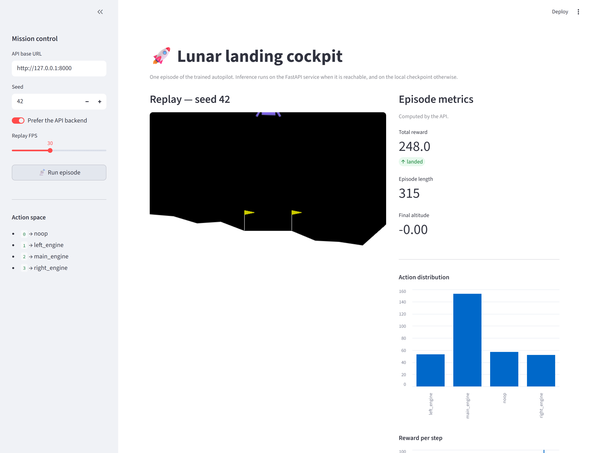
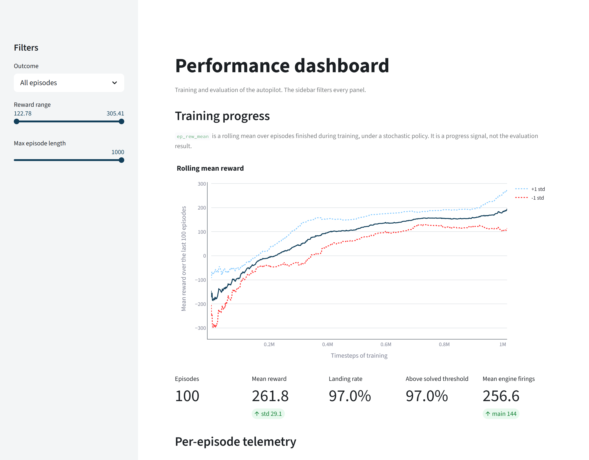

# The two pages

The cockpit shows one episode as an animation, and the dashboard shows the published
evaluation. Both are optional Streamlit pages. `docs/architecture.md` explains where each page
gets its data, and this page describes what they show and the display rules they follow.

```powershell
uv sync --all-extras
uv run streamlit run src/rl_lander/gui.py               # the cockpit
uv run streamlit run src/rl_lander/dashboard.py         # the dashboard
```

The `ui` extra installs Streamlit and Plotly. `pyproject.toml` keeps it out of the default
install for two reasons. The training and evaluation code has no use for a web framework, and on
Windows the pyarrow package that comes with Streamlit faulted when its native libraries loaded
after Box2D.

## The cockpit

<!-- source: docs/images/MANIFEST.json -->


| On screen | What it shows |
|---|---|
| The sidebar | the address of the service, the seed of the episode, the toggle that chooses between the service and the local checkpoint, and the frame rate of the replay |
| The replay | the animation, rendered by the page from the actions of the episode |
| Total reward, outcome, length, final altitude | the score of the flight, whether it landed, how many steps it lasted and the altitude it ended at |
| Action distribution | the number of steps on which each of the four actions was chosen, doing nothing included; each engine firing lowers the reward |
| Reward per step | where in the descent the score was gained or lost |

The page follows two rules. The metrics panel states whether the API or the local model computed
its numbers, so a reader knows which process produced them. When the local replay and the
returned trajectory disagree, the page shows a red error above the animation, which says that
the two are not running the same environment version. The check is
`rl_lander.replay.replay_matches`, and `docs/architecture.md` describes what it compares.

## The dashboard

<!-- source: docs/images/MANIFEST.json -->


| Section | The question it answers |
|---|---|
| Training progress | how the rolling mean reward of the shipped run rose during training |
| The five cards | episodes, mean reward, landing rate, share above the threshold, mean engine firings |
| Per-episode telemetry | how the rewards are distributed, and where the lander came to rest |
| Engine use | how the mean reward varies with the number of engine firings, by quartile |

Its inputs are `reports/evaluation_episodes.csv` and `reports/training_curves.csv`, both
tracked by git. The cards and the episode charts are computed from the episodes that pass the
sidebar filters, and every section that shows episodes uses the same filtered set.

## Display rules

**Outcomes are text categories.** The CSV stores `landed` as 0 or 1. The dashboard maps these
values to the words `landed` and `did not land` before plotting, because Plotly treats an
integer column as continuous and would colour two values with a gradient.

**Reference lines are dotted.** On the scatter of resting positions, two dotted vertical lines at
x = −0.1 and x = +0.1 mark a band around the centre of the pad, in the palette's reference
colour. The dotted style keeps them distinct from the data points without relying on colour.

**Every axis has a title.** The `styled` helper in `rl_lander.charts` sets the background, the
font, the grid and both axis titles of every chart on the two pages, with colours taken from
`rl_lander.figure_style`. The data series use the same palette, with two exceptions that set no
colour and receive the defaults: the lines one standard deviation above and below the training
curve, and the bars of the engine-use chart.

## The Streamlit theme

`.streamlit/config.toml` sets the four theme colours of the pages to tokens of the palette the
figures use, and `tests/unit/test_theme.py` checks each of them against `rl_lander.figure_style`.
Without that file, Streamlit would draw its buttons, sliders and toggles in its default red, and
its editor toolbar would appear in the corner of each screenshot.
