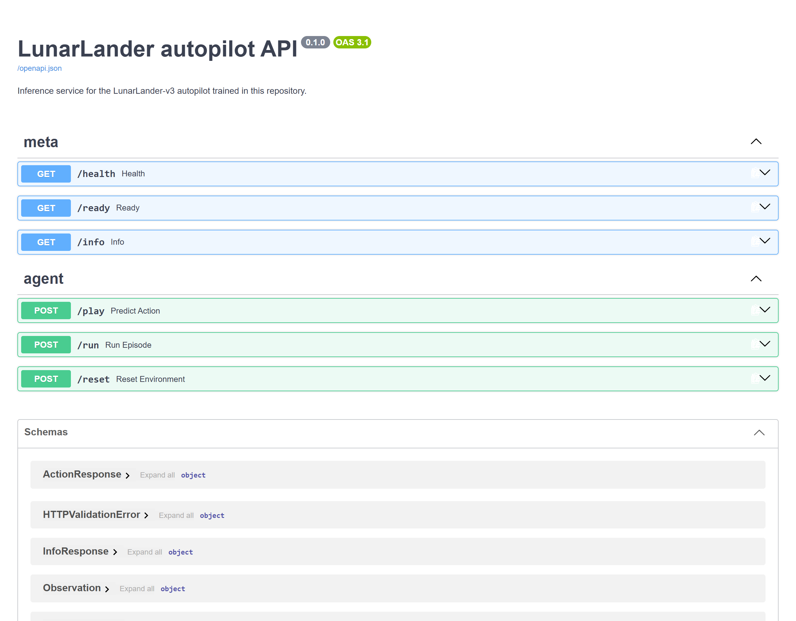

# Running the service

This page explains how to start the service, how to query it, and what to check when it stops
answering. `docs/architecture.md` explains why the policy is served by an API.

## Starting it

```powershell
uv sync --all-extras
uv run uvicorn rl_lander.api:app                        # http://127.0.0.1:8000/docs
```

No other step is needed. The service loads the checkpoint at `models/ppo/best.zip` once, at
start-up, in the application's `lifespan` function.

| Variable | Default | What it changes |
|---|---|---|
| `RL_LANDER_MODEL_PATH` | `models/ppo/best.zip` | the checkpoint to serve |
| `RL_LANDER_ALGO` | `ppo` | the class that loads it; `ppo` or `dqn` |
| `RL_LANDER_API_URL` | `http://127.0.0.1:8000` | where the cockpit looks for the service |
| `RL_LANDER_ROOT` | the directory holding `pyproject.toml` | the root every path hangs off |
| `PYTHONHASHSEED` | unset | string hashing, for a result that must be identical across machines |

`.env.example` documents the same variables except `RL_LANDER_ROOT`, with a comment on each, and
adds `CHROME_PATH`, the browser that `scripts/capture.py` uses for the screenshots. The service
has no secret to configure, since it uses no key, no database and no external service. No code
in the project loads a `.env` file. To use one, pass it to the command, as in
`uv run --env-file .env uvicorn rl_lander.api:app`, so that the command line shows where the
variables come from.

## In a container

```powershell
docker compose up --build    # the API on :8000, the dashboard on :8501
```

Both services are built from the same Dockerfile. The image holds the installed package and its
dependencies, the checkpoint under `models/`, the published exports under `reports/` and the
Streamlit theme. `.dockerignore` keeps `docs/`, `notebooks/`, `scripts/`, `tests/` and `var/`
out of the build context. Three settings are worth knowing before the first `up`.

| | |
|---|---|
| **The CPU build of PyTorch** | `tool.uv.sources` takes torch from PyTorch's CPU index on every platform except Windows. Without that rule, the Linux resolution would install the CUDA build, which the comment in the CI workflow puts at about three gigabytes more. |
| **`SDL_VIDEODRIVER=dummy`** | The image sets this variable so that SDL, which pygame uses to draw frames, does not look for a display. Neither service draws frames, because `/run` returns actions and rewards and the dashboard reads files. |
| **The health check queries `/health`** | `/health` answers 200 whenever the process is serving, and `/ready` answers 503 when no checkpoint is loaded. With `/ready` as the probe, a missing checkpoint would mark the API container unhealthy, and the dashboard, which `docker-compose.yml` starts only once the API container is healthy, would stay down. The next section lists what each route answers. |

The cockpit is not one of the services. For each episode it replays the actions in Box2D,
renders every frame with pygame and encodes the frames as a GIF, all inside the Streamlit
process. The packages for this work are already in the image. Serving the cockpit from a
container would therefore put that rendering work in the container for every episode requested,
and `RL_LANDER_API_URL` would have to point to the API service. On a workstation, the cockpit
runs with the `uv run streamlit` command given in the README.

The first run of the shipped policy inside the container scored 280.34 on the episode with seed
2024. The same episode scores 280.49 in the first row of `reports/evaluation_episodes.csv`, on
the machine that produced that file. The checkpoint is the same file. The difference comes
from the Windows and Linux builds of the numerical libraries, and the repository does not
isolate which one. The exact reproducibility described in `docs/data-source.md` therefore
applies within one platform.

## What answers

<!-- source: docs/images/MANIFEST.json -->


| Route | Method | Answers |
|---|---|---|
| `/health` | GET | the process is serving |
| `/ready` | GET | a checkpoint is loaded, and which one |
| `/info` | GET | algorithm, environment, version, checkpoint path, action labels |
| `/play` | POST | the deterministic action for one observation |
| `/run` | POST | a whole episode: actions, rewards, total reward, length, landing flag, final state |
| `/reset` | POST | a starting observation for a given seed |

FastAPI generates the page above from the routes and their Pydantic models, so it documents the
shape of each request and response. The bounds check on observations runs in a validator and
does not appear on the page. `docs/architecture.md` explains why `/health` and `/ready` are
separate routes.

`POST /run` takes the longest, since it simulates up to a thousand environment steps before it
answers. The other routes answer in a few milliseconds.

## When something goes wrong

| Symptom | Likely cause | What to do |
|---|---|---|
| `/ready` answers 503 | no checkpoint at the path the service resolved; `/info`, `/play` and `/run` answer 503 too | check that `RL_LANDER_MODEL_PATH`, or `models/ppo/best.zip` when the variable is unset, points to a checkpoint |
| A `/play` call returns 422 | the observation is not eight finite numbers within the environment's bounds | read the message, which names the index and the bounds of a value out of range |
| The service fails at start-up with `'ActorCriticPolicy' object has no attribute 'q_net'` or `unexpected keyword argument 'use_sde'` | the checkpoint was saved by the other algorithm | set `RL_LANDER_ALGO` to match |
| The cockpit says the replay diverged | the page and the service run different environment versions | reinstall both from the lock file |
| The dashboard says an export is missing columns | an older version of the pipeline wrote it | for `evaluation_episodes.csv`, run `scripts/evaluate_and_export.py` again; for `training_curves.csv`, publish the run again with `scripts/publish_run.py` |

## What the service leaves out

**Container orchestration, queues and workers.** `docs/architecture.md` explains why one process
is enough for this service.

**Authentication.** The six routes change no state on the server, and the policy they serve is
public in this repository. An API key would therefore protect no data, and it would add a secret
to manage.

**Monitoring.** The service has no metrics endpoint, no tracing and no alerting. It is started by
hand, for a demonstration or for the cockpit, and stopped by hand.
