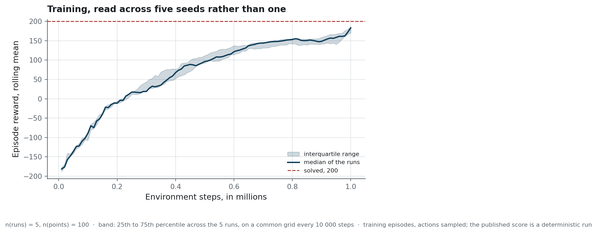

# The evaluation protocol

This page says what each published number measures, how it was obtained, and which population
the `±` beside it describes. `metrics.yaml` defines each metric column of the tables, and the
sections below describe how the tables were produced.

Three sources of variation affect a reinforcement-learning score: the training run that produced
the policy, the grid of episodes used to score it, and the individual episodes of that grid. A
report that holds two of them fixed and lets the third vary without naming it leaves its reader
unable to tell what its `±` describes.

## Conditions kept constant and conditions varied

| Kept constant | Varied on purpose, and measured |
|---|---|
| The environment: `LunarLander-v3`, no wind, default gravity | The **training seed**: 42 to 46, five independent runs |
| The budget: 1 000 000 steps per run | The **evaluation grid**: six grids of 100 episodes each |
| The hyper-parameters, outside the trials | One **hyper-parameter at a time**, in three trials |
| The scoring code: `run_episodes` and `summarise` in `training/evaluate.py`, used for every table | The **algorithm**, once: DQN at the same budget |

Each row of `reports/evaluation_episodes.csv` carries the seed of its episode, so any exported
episode can be replayed. `reports/evaluation_manifest.json` records the policy that was scored,
the git revision of the evaluation, and the installed version of each library that can change a
score, namely Gymnasium, Stable-Baselines3, NumPy, PyTorch and Box2D.

## The three standard deviations

Every `±` in this repository is a standard deviation, and the sentence beside it names the
population it was computed over. Three populations appear, and `metrics.yaml` has one entry for
each. All three are sample standard deviations, computed with ddof = 1.

| Entry in `metrics.yaml` | Population | Where it appears |
|---|---|---|
| `sd_across_episodes` | the 100 episodes of one grid, for one policy | the column of that name in the tables of runs and of grids |
| `sd_between_runs` | the five training seeds, each already averaged over its episodes | the headline score of the README |
| `sd_across_grids` | the six evaluation grids, for one policy | the stability of the shipped policy across grids |

Each column of a table holds one of the three. In the README's comparison with DQN, the first
row is the exception: its `sd_across_episodes` cell holds the between-run value and says so.

The headline number uses the second, because it alone describes the variation to expect when the
configuration is trained again. The first describes the episodes of one evaluation, and carries
no information about the training method. The earlier version of this repository published it
as if it described the method.

## How a run becomes the shipped policy

1. `scripts/train_study.py` trains the five seeds, the three trials and the DQN. Each run writes
   its checkpoints, its manifest and its training curve to its own directory under `var/runs/`.
2. Each run keeps **two** checkpoints under different names, `best.zip` and `final.zip`. The
   header of `scripts/compare_checkpoints.py` explains the difference, and the script measures
   what confusing the two costs. On the DQN run, their mean rewards differ by about 880 points.
3. `scripts/aggregate_study.py` summarises the study into `reports/seed_study.json`,
   `reports/hyperparameter_trials.csv` and `reports/learning_curve_band.csv`.
4. `scripts/publish_run.py --from-study` promotes the baseline run with the mean closest to the
   median of the five. Its docstring states this rule, and `median_run` breaks a tie in favour
   of the lower seed. The script also rejects a run during which no evaluation ran, since such
   a run has no best checkpoint.
5. `scripts/evaluate_and_export.py` scores the promoted policy again on the six grids and writes
   the exports. It then checks that every grid has a mean reward of at least 200, and the
   command ends with an error when a grid falls below, unless `--allow-below-threshold` is
   passed. The exports are written before this check, so a failing grid is reported after the
   files have been replaced.

The band from step 3 shows how the five runs progressed during training:

<!-- source: reports/figures/MANIFEST.json -->

> **How to read it.** The horizontal axis is training progress, in millions of environment
> steps. The line is the median of the five runs at each point of a common grid of steps, and
> the band spans their 25th to 75th percentiles, so its width shows how far the runs disagree at
> that point. The dashed line is Gymnasium's solved threshold of 200. The curve averages
> training episodes, which vary more than the deterministic evaluation behind the published
> score.

The median curve stays below the published score from start to finish. Its values are means
over the last hundred training episodes, whose actions are sampled from the policy's
distribution, while the published score comes from deterministic runs of the saved weights.
Because the two measurements differ in this way, the gap between them is not, by itself,
evidence that training stopped too early.

## What `landed` means

`landed` comes from the environment's terminal reward. When an episode terminates,
`LunarLander-v3` gives +100 on the last step if the lander has come to rest, and −100 if it has
crashed or left the frame. An episode cut off by the time limit of 1,000 steps receives neither
and counts as not landed. The three failures of the exported grid, seeds 2088, 2111 and 2118,
are of this kind: each ran for 1,000 steps without the lander coming to rest. `landed` is true
when the episode terminated with a positive last reward, and the score is kept in a separate
column.

Gymnasium's documentation calls an episode that scores at least 200 points a solution, and this
repository calls the task solved when the mean over 100 episodes reaches 200 (`SOLVED_THRESHOLD`
in `training/evaluate.py`). Neither threshold says whether an episode landed, and `RunResponse`
in `rl_lander.api` documents the same rule for the service. Reading `landed` from the score gave
the right rate on the shipped policy, whose landing rate and threshold rate are both 0.97, and a
wrong one on seed 44, whose landing rate is 0.98 and threshold rate 0.96.

## Reading the hyper-parameter trials

Each trial changes one parameter, trains a single run at seed 42 with the same budget, and is
scored by the same code. A single run cannot rank a parameter, and the last column of the table
accounts for this. It states whether the difference from the baseline exceeds the baseline's own
spread between seeds, 13.32, since a smaller difference could come from the seed alone.

Without that column, the four means could be read as a ranking. Such a reading would repeat, for
hyper-parameters, the error this repository corrects for its headline score, where one training
was reported as if it described the configuration.

## What the protocol does not give

**A narrow confidence interval on the spread.** Five seeds are enough to show that the training
seed moves the score and to publish a spread. Under a normal model, they give a 95% interval on
that spread of roughly 8 to 38 points around the measured 13.32, too wide to be useful. Twenty
seeds with the same spread would narrow it to roughly 10 to 19. The conclusion that retraining
moves the score more than the choice of evaluation grid holds with five, since even the lower
end of the interval, about 8, is more than twice the spread of 3.33 measured across grids.

**A worst-case guarantee.** One hundred episodes per grid estimate the mean well and the tail of
the distribution poorly, and the tail matters most for a landing autopilot. The README's table
across grids shows this. The grid means stay between 261.80 and 269.57, while the worst episode
ranges from 123 to 227.

**A ranking between PPO and DQN.** One DQN run against five PPO runs can show that DQN is
competitive on this task, and cannot show which algorithm is better. The header of
`scripts/train_study.py` explains why both algorithms get the same budget, where the defaults
of this repository's two configurations differ: one million steps for PPO and 200,000 for DQN.
